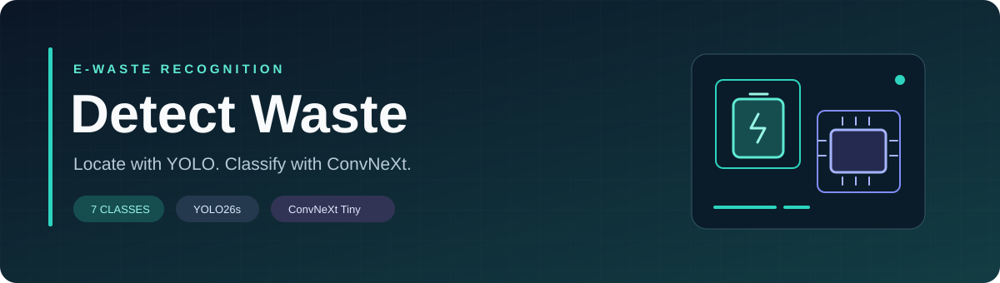
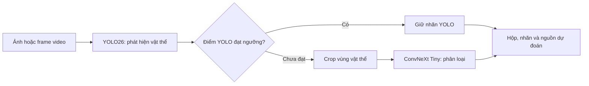
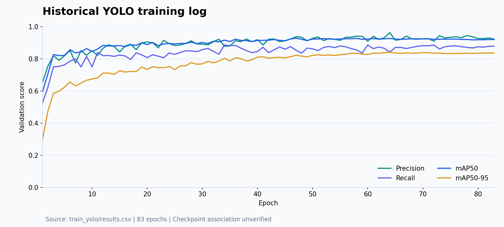

<p align="center">
  
</p>

<p align="center">
  <a href="https://github.com/doanhoainamdz/detect_waste/actions/workflows/ci.yml"></a>
  
  
  
  
</p>

# Detect Waste

**Nhận diện và phân loại rác thải điện tử bằng YOLO kết hợp CNN.** Dự án nghiên cứu khoa học sử dụng YOLO26 để định vị vật thể và ConvNeXt Tiny để phân loại lại những vùng ảnh có độ tin cậy thấp.

Hỗ trợ ảnh, video và webcam; có thể chạy YOLO độc lập hoặc chế độ kết hợp. Trọng số đã huấn luyện được lưu bằng **Git LFS**. Chạy nhận diện không cần tài khoản hay khóa API Roboflow.

## Các lớp nhận diện

| Nhãn mô hình | Loại rác điện tử |
|---|---|
| `battery` | Pin |
| `computer mouse` | Chuột máy tính |
| `keyboard` | Bàn phím |
| `laptop` | Máy tính xách tay |
| `mobile` | Điện thoại |
| `pcb` | Bảng mạch in |
| `phone charger` | Bộ sạc điện thoại |

## Bắt đầu

Cài **Python 3.11 trở lên**, Git và [Git LFS](https://git-lfs.com/). CPU có thể chạy suy luận; tốc độ phụ thuộc phần cứng, kích thước ảnh và số vật thể.

```bash
git lfs install
git clone https://github.com/doanhoainamdz/detect_waste.git
cd detect_waste
git lfs pull
python -m venv .venv
```

Kích hoạt môi trường trên **Windows PowerShell**:

```powershell
.\.venv\Scripts\Activate.ps1
```

Trên **Linux/macOS**:

```bash
source .venv/bin/activate
```

Cài thư viện:

```bash
python -m pip install --upgrade pip
python -m pip install -r requirements.txt
python main.py --help
```

Nếu dùng GPU NVIDIA, cài cặp PyTorch/torchvision phù hợp CUDA theo [hướng dẫn PyTorch](https://pytorch.org/get-started/locally/), rồi cài các thư viện của dự án.

## Chạy nhận diện

**Ảnh — YOLO + CNN:**

```bash
python main.py --source path/to/image.jpg
```

Kết quả mặc định: `outputs/image_annotated.jpg` và `outputs/image_annotated.json`. JSON ghi nhãn, tọa độ hộp, nguồn dự đoán và điểm tin cậy.

**Webcam — có cửa sổ xem trực tiếp:**

```bash
python main.py --source 0 --show
```

Nhấn **Q** hoặc **Esc** để dừng; video được lưu vào `outputs/webcam_annotated.mp4`. Khi chạy webcam không có `--show`, dùng **Ctrl+C** để dừng.

**Video:**

```bash
python main.py --source path/to/video.mp4 --output outputs/video
```

**Chỉ YOLO:**

```bash
python main.py --source path/to/image.jpg --mode yolo
```

**GPU và ngưỡng tùy chọn:**

```bash
python main.py --source path/to/image.jpg --device cuda:0 --conf 0.25 --cnn-threshold 0.6
```

| Tham số | Mặc định | Ý nghĩa |
|---|---|---|
| `--mode` | `hybrid` | `hybrid` hoặc `yolo` |
| `--device` | `cpu` | `cpu`, `cuda:0` hoặc chỉ số GPU `0` |
| `--conf` | `0.25` | Ngưỡng giữ lại phát hiện YOLO |
| `--cnn-threshold` | `0.6` | Chuyển crop sang CNN nếu điểm YOLO thấp hơn ngưỡng |
| `--yolo-weights` | `train_yolo/best6.pt` | Trọng số YOLO |
| `--cnn-weights` | `train_cnn/best_convnext_research5.pth` | Trọng số CNN |
| `--output` | `outputs/` | Thư mục kết quả |
| `--show` | Tắt | Mở cửa sổ xem kết quả |

Trong chế độ hybrid, `--conf` phải nhỏ hơn hoặc bằng `--cnn-threshold`.

## Cách mô hình kết hợp hoạt động



CNN nhận crop **RGB, 224 × 224**, chuẩn hóa ImageNet. Điểm YOLO và điểm softmax CNN là hai đại lượng khác nhau; JSON giữ riêng `detection_confidence` và `classification_confidence` khi dùng CNN. Màu xanh lá biểu thị YOLO, xanh dương biểu thị CNN.

Nếu YOLO không phát hiện được vật thể, chương trình trả danh sách rỗng. CNN chỉ phân loại vùng đã được YOLO phát hiện; nó không bổ sung vị trí cho vật thể bị bỏ sót. Xem [thông tin mô hình và giới hạn](docs/MODEL_CARD.md).

## Kết quả nghiên cứu

Kho lưu [nhật ký huấn luyện 83 epoch](train_yolo/results.csv) và [notebook nghiên cứu](notebooks/). Hình dưới được tạo trực tiếp từ CSV:



Các đường trên là **chỉ số validation được lưu trong CSV**, không phải kết quả đánh giá mới của bản mã này. Chưa xác nhận CSV tương ứng chính xác với checkpoint `best6.pt`; không dùng chúng làm cam kết chất lượng của checkpoint hoặc mô hình hybrid. [Chi tiết nguồn dữ liệu và thí nghiệm](docs/RESEARCH.md).

## Tải dữ liệu và dùng notebook

```bash
python -m pip install -r requirements-research.txt
```

Đặt khóa Roboflow trong biến môi trường. Ví dụ PowerShell:

```powershell
$env:ROBOFLOW_API_KEY = "your_roboflow_api_key"
python scripts/download_dataset.py --version 21
```

Linux/macOS:

```bash
export ROBOFLOW_API_KEY="your_roboflow_api_key"
python scripts/download_dataset.py --version 21
```

`.env.example` chỉ là mẫu; chương trình đọc biến môi trường, không tự nạp file `.env`. Cần có quyền truy cập dataset Roboflow. Dữ liệu tải về nằm trong `data/` và được Git bỏ qua.

Notebook CNN dùng nhiều phiên bản dataset; notebook YOLO hiện có dùng phiên bản 7. Các notebook giữ vai trò lưu thí nghiệm Colab/Kaggle, cần chỉnh đường dẫn và chọn cell phù hợp trước khi chạy. Không yêu cầu chạy notebook để dùng `main.py`. Xem [hướng dẫn notebook](notebooks/README.md).

## Cấu trúc kho

```text
detect_waste/
├── main.py                       # Chạy ảnh, video và webcam
├── module/                       # YOLO, CNN và logic kết hợp
├── scripts/                      # Tải dataset, kiểm tra bản xuất bản
├── train_yolo/                   # Trọng số YOLO và nhật ký huấn luyện
├── train_cnn/                    # Trọng số ConvNeXt Tiny
├── notebooks/                    # Notebook nghiên cứu đã bỏ khóa và output
├── docs/                         # Thông tin mô hình, nghiên cứu và biểu đồ
├── tests/                        # Kiểm tra xử lý ảnh và logic kết hợp
├── models_manifest.json          # Dung lượng, SHA-256 và thứ tự nhãn
├── requirements.txt              # Thư viện suy luận
└── requirements-research.txt     # Thư viện nghiên cứu bổ sung
```

## Kiểm tra

```bash
python -m unittest discover -s tests -v
python scripts/check_repository.py
python scripts/check_repository.py --weights
```

Lệnh cuối xác minh SHA-256 của hai trọng số sau `git lfs pull`. GitHub Actions chạy các kiểm tra mã và notebook mà không tải trọng số lớn. Xem [đóng góp và phát triển](CONTRIBUTING.md).

## Khắc phục nhanh

- **Thiếu trọng số / file LFS pointer:** chạy `git lfs install` và `git lfs pull`. File thật có dung lượng khoảng 19,39 MiB và 106,21 MiB. Tải ZIP từ GitHub có thể không bao gồm nội dung trọng số.
- **Không có GPU CUDA:** dùng `--device cpu` hoặc cài đúng bản PyTorch cho GPU.
- **Webcam không mở:** kiểm tra quyền camera, ứng dụng khác đang dùng camera và thử `--source 1`.
- **Notebook lỗi đường dẫn:** thay các đường dẫn `/content/`, `/kaggle/` và Google Drive bằng vị trí dữ liệu trên môi trường đang chạy.

## Tác giả và thành phần sử dụng

Dự án của [Đoàn Hoài Nam](https://github.com/doanhoainamdz), nghiên cứu ứng dụng học sâu trong nhận dạng và phân loại rác thải điện tử.

Sử dụng [Ultralytics YOLO](https://docs.ultralytics.com/), [PyTorch](https://pytorch.org/), [torchvision](https://docs.pytorch.org/vision/stable/) và [Roboflow](https://roboflow.com/). Dataset và thư viện phụ thuộc có điều khoản sử dụng riêng; việc công khai kho không thay thế các điều khoản đó. Kho chưa áp dụng giấy phép riêng cho mã và tài liệu của tác giả.
